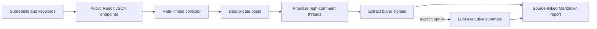

# Reddit Customer Research

Turn public Reddit threads into a source-linked buyer research report covering pains, purchase triggers, objections, customer language, and competitor mentions.

## Why I built it

Customer research often gets summarized into generic personas that are difficult to verify. I built this to collect the discussions where buyers explain their problems in their own words, then keep every reported signal connected to its source thread. It gives a sales or product team useful language without requiring a Reddit API key or a black-box analysis step.

## How it works



- Collects top, hot, and keyword-matched posts from named subreddits.
- Pulls comments from the threads with the most discussion, where objections and tradeoffs tend to appear.
- Scores evidence with transparent keyword rules and detects repeated phrases across separate comments.
- Tracks configured competitor names and reports a clearly labeled heuristic direction.
- Prints Markdown to standard output and only writes files when an output path is supplied.

## Guardrails and design decisions

- **Polite collection:** A shared client enforces at least one second between requests. The default is 1.1 seconds.
- **Bounded retries:** HTTP 429 responses wait at least 30 seconds. Temporary server and network failures use bounded retries, then that endpoint is skipped.
- **Narrow endpoints:** Subreddit names and search terms are validated before they can become request paths or query parameters.
- **Data minimization:** The normalized dataset excludes usernames, profile data, cookies, and authentication data. Only post context, comment text, engagement counts, and source links are retained.
- **Evidence before inference:** Deterministic analysis works without an LLM. Repeated-language claims require the phrase to appear in at least two comments.
- **Short, linked excerpts:** Quotes are limited to 24 words and link to the full thread for context.
- **Safe rendering:** Markdown and HTML control characters in collected text are escaped before a report is printed.
- **Explicit LLM opt-in:** No LLM call occurs unless `LLM_SUMMARY_ENABLED=true`. The prompt treats collected text as untrusted data, and only the compact findings payload is sent.
- **Overwrite protection:** Existing report and raw-data files are not replaced unless `--force` is passed.
- **Offline means offline:** Demo mode loads a fictional local fixture and never initializes the Reddit or LLM clients.

Public JSON endpoints are unauthenticated interfaces and can change. This project fails with a clear message when no posts can be collected instead of fabricating a report.

## Quick start

### Offline demo

The demo needs no keys and uses fictional dental-practice discussions.

```bash
python3 -m venv .venv
source .venv/bin/activate
python -m pip install -r requirements-dev.txt
python -m pip install -e .
reddit-customer-research demo
pytest
```

To save the printed demo report:

```bash
reddit-customer-research demo --output reports/demo.md
```

### Live Reddit research

Reddit collection does not require an API key. Set a descriptive user agent, then provide the niche, communities, search terms, and competitor names.

```bash
export REDDIT_USER_AGENT="reddit-customer-research/1.0 (contact: your-email@example.com)"

reddit-customer-research live \
  --niche "inventory software for independent repair shops" \
  --subreddits "AutoRepair,mechanics" \
  --keywords "inventory software,parts tracking,shop management" \
  --competitors "Example Tool A,Example Tool B" \
  --output reports/repair-shop-research.md \
  --raw-output raw/repair-shop-source.json
```

The `raw/` file contains normalized public content without Reddit usernames. Both `raw/` and `reports/` are ignored by Git.

### Optional LLM summary

Copy the example settings and explicitly enable the summary step. The rest of the report remains deterministic.

```bash
cp .env.example .env
set -a
source .env
set +a

export LLM_SUMMARY_ENABLED=true
export LLM_API_KEY="replace-with-your-key"
reddit-customer-research live \
  --niche "inventory software for independent repair shops" \
  --subreddits "AutoRepair,mechanics"
```

`LLM_SUMMARY_ENDPOINT` defaults to the OpenAI Responses endpoint and can be changed to a compatible HTTPS endpoint. Secrets are read from the environment and never written to output.

## Example output

This excerpt comes from `reddit-customer-research demo`:

```markdown
# Buyer Research Report: appointment reminder software for independent dental practices

Collected 2026-02-12 from r/FictionalDentalOps, r/FictionalPractice. Analyzed 4 posts and 12 comments.

## Executive summary

The strongest pattern is double entry. Buyers begin evaluating alternatives when the issue creates a visible operating burden, but migration can stall the decision.

## Pains

- "The no show scramble is exhausting. We do double entry every morning and still miss schedule changes." ([source thread](https://example.com/r/FictionalDentalOps/comments/demo101))

## Words customers actually use

- `no show scramble`: 3 uses
- `month to month`: 3 uses
- `double entry`: 3 uses

## Competitor mentions

| Competitor | Mentions | Direction |
| --- | ---: | --- |
| Northwind Scheduler | 2 | mostly positive |
| Blue Harbor Recall | 2 | mixed or neutral |
| Maple Finch Forms | 1 | mixed or neutral |
```

All names, discussions, communities, and links in the demo fixture are fictional.

## Tech

- Python 3.10 or newer
- Requests for bounded HTTP calls
- Reddit public `.json` endpoints
- Pytest for offline tests
- Standard-library dataclasses, JSON, regular expressions, and argument parsing

## License

MIT. Copyright (c) 2026 Christian Terrone.
